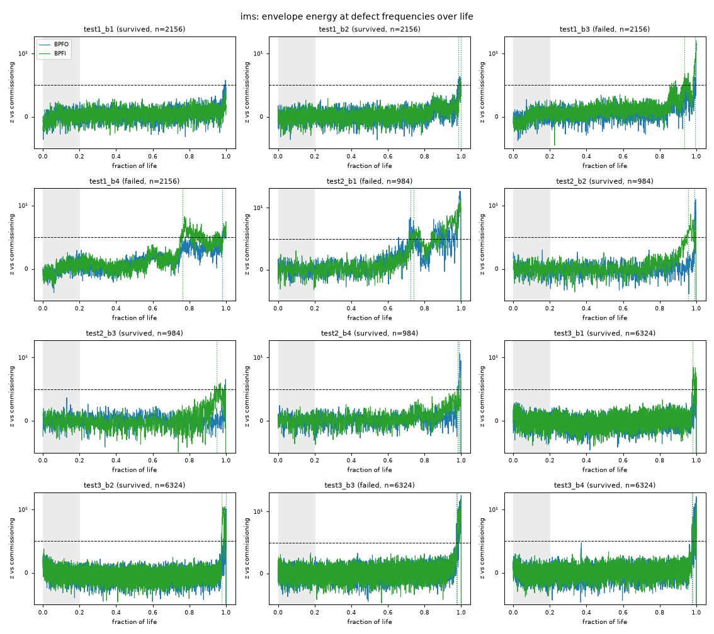
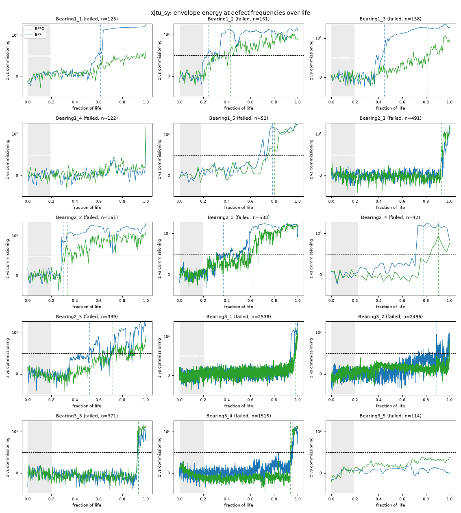

# Phase 0 feasibility: physics indicators over bearing life

Threshold: mean + 5σ of the first 20% of snapshots (min 10); departure = 3 consecutive snapshots above it. Cells show the fraction of life at first departure (— = never).

**Gate:** BPFO/BPFI departs before end of life on the IMS outer-race bearing and on most XJTU-SY bearings, while bearings that survived stay quiet. Verdict is written by a human in this PR.

## ims

- Failed bearings with a BPFO or BPFI departure before end of life: **4 / 4**
- Bearings that survived but still departed (false-alarm analogue): **7 / 8**

| bearing | outcome | snapshots | BPFO | BPFI | RMS | kurtosis | speed / defect source |
|---|---|---|---|---|---|---|---|
| test1_b1 | survived | 2156 | — | — | 1.00 | — | metadata:speed_rpm / metadata:bpfo(order) |
| test1_b2 | survived | 2156 | 0.99 | 1.00 | 0.98 | — | metadata:speed_rpm / metadata:bpfo(order) |
| test1_b3 | bearing 3 inner race; bearing 4 roller element | 2156 | 0.99 | 0.94 | 0.98 | 0.47 | metadata:speed_rpm / metadata:bpfo(order) |
| test1_b4 | bearing 3 inner race; bearing 4 roller element | 2156 | 0.98 | 0.76 | 0.76 | 0.69 | metadata:speed_rpm / metadata:bpfo(order) |
| test2_b1 | bearing 1 outer race | 984 | 0.72 | 0.74 | 0.55 | 0.71 | metadata:speed_rpm / metadata:bpfo(order) |
| test2_b2 | survived | 984 | 0.99 | 0.95 | 0.85 | — | metadata:speed_rpm / metadata:bpfo(order) |
| test2_b3 | survived | 984 | — | 0.95 | 0.92 | — | metadata:speed_rpm / metadata:bpfo(order) |
| test2_b4 | survived | 984 | 0.99 | 0.98 | 0.71 | 0.95 | metadata:speed_rpm / metadata:bpfo(order) |
| test3_b1 | survived | 6324 | — | 0.98 | 0.98 | 0.94 | metadata:speed_rpm / metadata:bpfo(order) |
| test3_b2 | survived | 6324 | 1.00 | 0.98 | 0.97 | — | metadata:speed_rpm / metadata:bpfo(order) |
| test3_b3 | bearing 3 outer race | 6324 | 0.97 | 0.98 | 0.94 | 0.97 | metadata:speed_rpm / metadata:bpfo(order) |
| test3_b4 | survived | 6324 | 0.97 | 0.98 | 0.37 | — | metadata:speed_rpm / metadata:bpfo(order) |

Metadata schema: `ims_schema.json`

## xjtu_sy

- Failed bearings with a BPFO or BPFI departure before end of life: **13 / 15**

| bearing | outcome | snapshots | BPFO | BPFI | RMS | kurtosis | speed / defect source |
|---|---|---|---|---|---|---|---|
| Bearing1_1 | outer race | 123 | 0.61 | — | 0.63 | — | metadata:speed_rpm / metadata:bpfo(order) |
| Bearing1_2 | outer race | 161 | 0.24 | 0.43 | 0.24 | 0.29 | metadata:speed_rpm / metadata:bpfo(order) |
| Bearing1_3 | outer race | 158 | 0.45 | 0.81 | 0.41 | 0.40 | metadata:speed_rpm / metadata:bpfo(order) |
| Bearing1_4 | cage | 122 | — | — | — | 0.67 | metadata:speed_rpm / metadata:bpfo(order) |
| Bearing1_5 | inner race; outer race | 52 | 0.78 | 0.80 | 0.65 | 0.98 | metadata:speed_rpm / metadata:bpfo(order) |
| Bearing2_1 | inner race | 491 | 0.95 | 0.93 | 0.93 | 0.93 | metadata:speed_rpm / metadata:bpfo(order) |
| Bearing2_2 | outer race | 161 | 0.30 | 0.33 | 0.30 | 0.31 | metadata:speed_rpm / metadata:bpfo(order) |
| Bearing2_3 | cage | 533 | 0.37 | 0.62 | 0.25 | 0.24 | metadata:speed_rpm / metadata:bpfo(order) |
| Bearing2_4 | outer race | 42 | 0.78 | 0.90 | 0.78 | — | metadata:speed_rpm / metadata:bpfo(order) |
| Bearing2_5 | outer race | 339 | 0.52 | 0.72 | 0.43 | — | metadata:speed_rpm / metadata:bpfo(order) |
| Bearing3_1 | outer race | 2538 | 0.94 | 0.98 | 0.94 | 0.98 | metadata:speed_rpm / metadata:bpfo(order) |
| Bearing3_2 | inner race; rolling element; cage; outer race | 2496 | 0.89 | — | 0.67 | — | metadata:speed_rpm / metadata:bpfo(order) |
| Bearing3_3 | inner race | 371 | 0.94 | 0.94 | 0.93 | 0.92 | metadata:speed_rpm / metadata:bpfo(order) |
| Bearing3_4 | inner race | 1515 | 0.95 | 0.94 | 0.94 | 0.95 | metadata:speed_rpm / metadata:bpfo(order) |
| Bearing3_5 | outer race | 114 | — | — | — | — | metadata:speed_rpm / metadata:bpfo(order) |

Metadata schema: `xjtu_sy_schema.json`

---
Run: https://github.com/data2dev/bearing_shift/actions/runs/45052537747
Commit: 7baa8167ca06d17bc4d18d4ea4debaf5d5e7f0b3
Datasets: ims xjtu_sy
